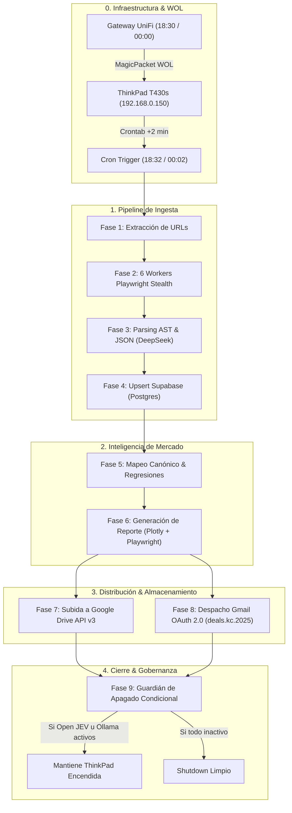

# 00 - Dashboard Maestro & Arquitectura End-to-End (Scraper NeoAuto)

> **ID del Sistema:** `NEOAUTO-SCRAPER-APPLIANCE-V2`  
> **Host Oficial de Ejecución:** `ThinkPad T430s` (`192.168.0.150`)  
> **Almacenamiento Físico Primario:** Caddy HDD Secundario (`/mnt/caddy_storage/Scraper.Neoauto` / `Z:\Scraper.Neoauto`)  
> **Controlador WOL:** Gateway UniFi Dream Machine (`192.168.0.1`)  
> **Base de Datos Central:** Supabase PostgreSQL (`urls_autos_diarios`, `autos_detalles`)  
> **Fecha de Certificación:** 23 de Octubre de 2026  

---

## 1. Visión Ejecutiva y Propósito

El sistema **Scraper NeoAuto** es un pipeline agéntico e industrial de inteligencia de mercado automotriz. Su objetivo es recolectar de forma diaria y semanal el 100% de los anuncios de venta de vehículos en el portal **NeoAuto Perú**, normalizar las especificaciones técnicas con modelos de lenguaje y reglas heurísticas, calcular curvas de depreciación y valoración estadística de mercado, generar un informe ejecutivo de alta fidelidad en formato HTML/PDF, archivarlo en Google Drive y distribuirlo automáticamente por correo a los operadores.

Todo el procesamiento ocurre en un nodo **Headless LAN 24/7 a costo $0.00** sobre la ThinkPad T430s con gráficos integrados Intel (consumo energético optimizado de ~12W).



---

## 2. Mapa de Fases Documentadas (Índice de la Bóveda)

Cada fase cuenta con su manual técnico de ingeniería, comandos de depuración y flujo detallado:

| Fase | Enlace a Documento | Propósito Técnico Principal |
| :---: | :--- | :--- |
| **01** | [[01 - Fase 1 - Despertar WOL UniFi & Encendido Headless]] | Configuración de NIC `enp0s25`, scripts en Gateway UniFi y BIOS. |
| **02** | [[02 - Fase 2 - Extraccion de URLs (Pipeline Diario vs Semanal)]] | Paginación profunda, captura de deltas y deduplicación inicial. |
| **03** | [[03 - Fase 3 - Multi-Worker Scraping Paralelo (Playwright Stealth)]] | Ejecución concurrente en 6 hilos sin colisiones ni detección antibot. |
| **04** | [[04 - Fase 4 - Normalizacion & Parsing JSON (Motor DeepSeek)]] | Estructuración de texto sucio a JSON tipado y paridad cambiaria. |
| **05** | [[05 - Fase 5 - Ingesta & Persistencia en Supabase]] | Arquitectura de datos relacional, índices de búsqueda y healthchecks. |
| **06** | [[06 - Fase 6 - Inteligencia Estadistica & Regresion de Mercado]] | Curvas de depreciación, medianas móviles por año y métrica FSR. |
| **07** | [[07 - Fase 7 - Compilacion del Reporte (HTML & PDF Playwright)]] | Ensamblado modular, optimización base64 (~74%) y renderizado Chromium. |
| **08** | [[08 - Fase 8 - Almacenamiento en Google Drive & Enlaces Compartibles]] | API v3 de Google Drive, subida de archivos pesados y enlaces directos. |
| **09** | [[09 - Fase 9 - Gateway de Despacho Gmail OAuth 2.0]] | Autenticación OAuth 2.0, refresh tokens y distribución de emails. |
| **10** | [[10 - Fase 10 - Guardian de Apagado Condicional & Backup Restic 3-2-1]] | Reglas de apagado inteligente, Open JEV, Ollama y política Restic. |

---

## 3. Matriz Comparativa: Pipeline Diario vs. Pipeline Semanal

El sistema opera bajo dos modalidades con cargas de trabajo y alcances diferenciados:

| Parámetro | Pipeline Diario | Pipeline Semanal |
| :--- | :--- | :--- |
| **Disparo UniFi WOL** | Diario a las 18:30 PM | Lunes a las 00:00 AM |
| **Disparo Crontab Local** | 18:32 PM (2 min post WOL) | 00:02 AM (2 min post WOL) |
| **Script Maestro** | `run_scraper_sequence_diario.sh` | `run_scraper_semanal.sh` |
| **Alcance Temporal** | Últimas 24 a 48 horas | Catálogo histórico completo |
| **Volumen Típico de URLs** | 80 - 180 anuncios nuevos | 8,000 - 15,000 anuncios |
| **Tiempo Promedio Ejecución** | 25 - 45 minutos | 4.5 - 7.0 horas |
| **Destinatarios del Reporte** | `rgutil@gmail.com`, `annyred9@gmail.com` | Equipo Comercial & Inversionistas |
| **Telemetría Pantalla** | Directo en tty1 (`/dev/tty1`) | Directo en tty1 (`/dev/tty1`) |

---

## 4. Topología de Almacenamiento y Rutas Críticas

Por mandato de ingeniería del sistema, **todo el proceso reside en el disco mecánico del Caddy (`/mnt/caddy_storage`)** para garantizar ciclos de escritura ilimitados y proteger el SSD del sistema:

- **Directorio Raíz en ThinkPad:** `/mnt/caddy_storage/Scraper.Neoauto`
- **Punto de Montaje Samba en Windows:** `Z:\Scraper.Neoauto`
- **Entorno Virtual Python:** `/mnt/caddy_storage/Scraper.Neoauto/.venv`
- **Logs de Auditoría:** `/mnt/caddy_storage/Scraper.Neoauto/scraper_sequence.log`
- **Imágenes Descargadas:** `/mnt/caddy_storage/Scraper.Neoauto/Autos.Richard.Gutierrez/downloaded_images/`
- **Reportes Generados:** `/mnt/caddy_storage/Scraper.Neoauto/Autos.Richard.Gutierrez/reporte_autos_*.pdf`

---

## 5. Comandos de Operación y Diagnóstico Rápido

### Lanzamiento Manual Diario (desde terminal Windows vía SSH):
```bash
ssh -i C:\Users\rguti\.ssh\id_thinkpad_antigravity richgutz@192.168.0.150 "bash /mnt/caddy_storage/Scraper.Neoauto/run_scraper_sequence_diario.sh"
```

### Inspección en Vivo de la Pantalla Negra de la ThinkPad (`tty1`):
```bash
ssh -i C:\Users\rguti\.ssh\id_thinkpad_antigravity richgutz@192.168.0.150 "tail -f /mnt/caddy_storage/Scraper.Neoauto/scraper_sequence.log"
```

### Prueba de Envío de Email con Último Reporte:
```bash
ssh -i C:\Users\rguti\.ssh\id_thinkpad_antigravity richgutz@192.168.0.150 "cd /mnt/caddy_storage/Scraper.Neoauto && .venv/bin/python Autos.Richard.Gutierrez/email_result.py"
```
