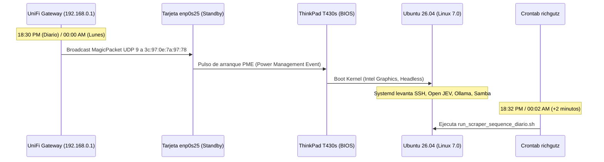

# 01 - Fase 1: Despertar WOL UniFi & Encendido Headless

> **Fase del Proceso:** 01 de 10  
> **Disparador:** Gateway UniFi (`192.168.0.1`) ➔ Tarjeta Ethernet `enp0s25`  
> **MAC Address ThinkPad:** `3c:97:0e:7a:97:78`  
> **Retorno:** [[00 - Dashboard Maestro & Arquitectura End-to-End]]  

---

## 1. Arquitectura de Encendido Remoto (Wake-on-LAN)

Para garantizar un funcionamiento industrial autónomo sin requerir que la ThinkPad T430s esté encendida consumiendo energía todo el día, el Gateway UniFi Dream Machine (`192.168.0.1`) actúa como el **Director de Orquesta de Energía**:



---

## 2. Configuración en el Gateway UniFi (`192.168.0.1`)

El Gateway UniFi tiene programado en su cron interno el envío de paquetes mágicos hacia la MAC de la ThinkPad mediante el binario `ether-wake`:

- **Ruta del script en UniFi:** `/data/bridge_wol.sh`
- **Comando de envío:**
  ```bash
  /usr/sbin/ether-wake -b 3c:97:0e:7a:97:78
  ```
- **Cronograma UniFi:**
  * Diario: `30 18 * * * /data/bridge_wol.sh` (18:30 PM)
  * Semanal: `00 00 * * 1 /data/bridge_wol.sh` (00:00 AM Lunes)

---

## 3. Configuración de Hardware y BIOS en la ThinkPad

1. **Configuración de Gráficos (Anti-Crash):**
   - **Ajuste:** `Integrated Graphics` exclusivamente (NVIDIA NVS desactivada).
   - **Motivo:** Evita el fallo de memoria `nouveau MMIO FAULT` que congelaba la terminal `tty1`. Consume ~12W y mantiene el chasis frío 24/7.
2. **Wake On LAN en BIOS:**
   - `Config` ➔ `Network` ➔ `Wake On LAN` = `[Enabled]`
   - `Wake On LAN from Dock` = `[Enabled]`
3. **Persistencia en Linux (`ethtool`):**
   La interfaz `enp0s25` está configurada con bandera `g` (MagicPacket) mediante el servicio persistente `/etc/systemd/system/wol.service`:
   ```ini
   [Unit]
   Description=Enable Wake-on-LAN on enp0s25
   After=network.target

   [Service]
   Type=oneshot
   ExecStart=/sbin/ethtool -s enp0s25 wol g

   [Install]
   WantedBy=basic.target
   ```

---

## 4. Sincronización de Crontab en ThinkPad

El crontab del usuario `richgutz` está sincronizado con 2 minutos de holgura tras el envío del MagicPacket para asegurar que el sistema operativo y el almacenamiento Samba/Caddy estén 100% listos:

```bash
# Crontab de richgutz (ThinkPad T430s)
32 18 * * * /mnt/caddy_storage/Scraper.Neoauto/run_scraper_sequence_diario.sh
02 00 * * 1 /mnt/caddy_storage/Scraper.Neoauto/run_scraper_semanal.sh
```

---

## 5. Auditoría y Comprobación en Vivo

Para validar que el soporte WOL está activo en la interfaz de red:
```bash
ssh -i C:\Users\rguti\.ssh\id_thinkpad_antigravity richgutz@192.168.0.150 "sudo ethtool enp0s25 | grep Wake-on"
# Salida esperada:
# Supports Wake-on: pumbg
# Wake-on: g
```
