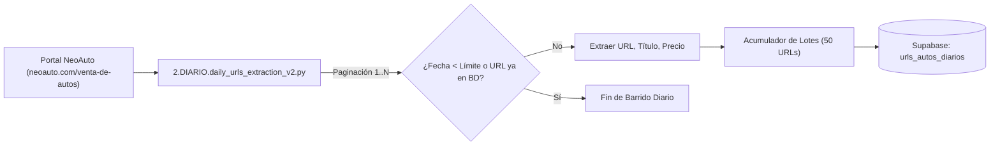

# 02 - Fase 2: Extracción de URLs (Pipeline Diario vs Semanal)

> **Fase del Proceso:** 02 de 10  
> **Scripts Clave:** `extractores/2.DIARIO.daily_urls_extraction_v2.py` / `extractores/1.SEMANAL...`  
> **Tabla Destino:** `urls_autos_diarios` (Supabase)  
> **Retorno:** [[00 - Dashboard Maestro & Arquitectura End-to-End]]  

---

## 1. Estrategia de Descubrimiento de URLs

El extractor de URLs es el sensor primario del sistema. Su objetivo es barrer el catálogo de NeoAuto para detectar publicaciones nuevas o actualizadas, extrayendo el enlace canónico, la marca preliminar, el modelo preliminar y la fecha de publicación.



---

## 2. Diferencias Técnicas: Extracción Diaria vs. Semanal

### Pipeline Diario (`2.DIARIO.daily_urls_extraction_v2.py`):
- **Criterio de Parada:** El extractor avanza página por página ordenadas por *Más Recientes*. Si encuentra 3 páginas consecutivas donde todos los anuncios ya fueron insertados en la base de datos o su fecha de publicación es anterior a 48 horas, se detiene de forma inteligente.
- **Volumen Típico:** 80 a 180 anuncios nuevos por ejecución.
- **Duración:** 2 a 4 minutos.

### Pipeline Semanal:
- **Criterio de Parada:** Barre el árbol completo de categorías, marcas y rangos de precio para el catálogo nacional de Perú (más de 15,000 publicaciones).
- **Deduplicación:** Cruza contra el histórico para identificar vehículos dados de baja (*delisted* o vendidos) y actualizar su estado.
- **Duración:** 45 a 90 minutos.

---

## 3. Formato del Payload de Extracción

Cada registro insertado en `urls_autos_diarios` contiene:

```json
{
  "url": "https://neoauto.com/auto/usado/toyota-rav4-2023-1234567",
  "categoria": "usado",
  "marca": "TOYOTA",
  "modelo": "RAV4",
  "fecha_registro": "2026-10-23T18:35:00Z",
  "procesado_scraping": false
}
```

---

## 4. Evasión de Bloqueos y Headers HTTP

El script utiliza peticiones con cabeceras que emulan navegadores reales en Windows/macOS:

```python
HEADERS = {
    'User-Agent': 'Mozilla/5.0 (Windows NT 10.0; Win64; x64) AppleWebKit/537.36 (KHTML, like Gecko) Chrome/131.0.0.0 Safari/537.36',
    'Accept-Language': 'es-PE,es-419;q=0.9,es;q=0.8,en;q=0.7',
    'Cache-Control': 'no-cache',
    'Pragma': 'no-cache',
}
```

---

## 5. Verificación de Ingesta en Terminal

Para auditar en vivo la cantidad de URLs capturadas hoy en Supabase:
```bash
ssh -i C:\Users\rguti\.ssh\id_thinkpad_antigravity richgutz@192.168.0.150 "cd /mnt/caddy_storage/Scraper.Neoauto && .venv/bin/python -c 'from extractores.supabase_client import get_supabase_client; sb = get_supabase_client(); print(sb.table("urls_autos_diarios").select("id", count="exact").execute().count)'"
```
