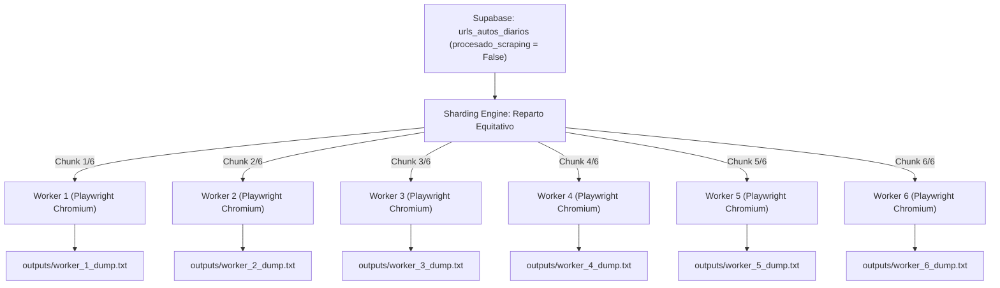

# 03 - Fase 3: Multi-Worker Scraping Paralelo (Playwright Stealth)

> **Fase del Proceso:** 03 de 10  
> **Script Clave:** `parallel_launcher.py`  
> **Tecnología:** Playwright Chromium Headless (Python Async)  
> **Salida:** Archivos de volcado HTML y `.txt` en `/outputs`  
> **Retorno:** [[00 - Dashboard Maestro & Arquitectura End-to-End]]  

---

## 1. Arquitectura de Scraping Concurrente en 6 Hilos

Para raspar cientos de publicaciones sin tiempos excesivos de espera ni colisiones, `parallel_launcher.py` implementa una división equitativa de URLs pendientes entre **6 trabajadores paralelos (Workers 1 al 6)**:



---

## 2. Parámetros de Evasión Antibot (Stealth Flags)

Cada instancia de Chromium corre con argumentos avanzados para evitar que los WAFs de Cloudflare o Akamai detecten la automatización:

```python
LAUNCH_ARGS = [
    "--disable-blink-features=AutomationControlled",
    "--no-sandbox",
    "--disable-setuid-sandbox",
    "--disable-infobars",
    "--window-position=0,0",
    "--ignore-certifcate-errors",
    "--ignore-certifcate-errors-spki-list",
]
```

Además, cada worker ejecuta una rotación dinámica de **Contextos de Navegador cada 5 peticiones**, renovando cookies, User-Agents y cachés temporales para asemejarse al comportamiento humano.

---

## 3. Control de Recursos y Protección de Memoria

- **RAM por Worker:** ~80 MB a 120 MB por instancia.
- **RAM Total en 6 Workers:** ~650 MB (la ThinkPad T430s cuenta con ~10.5 GB de RAM libre).
- **Control de Zombies:** Cada worker tiene timeout explícito por página (`timeout=25000` ms). Si una página se cuelga por red, se aborta y se reintenta hasta 2 veces antes de descartar.

---

## 4. Telemetría de Workers en Tiempo Real

El script imprime el progreso en tiempo real que se refleja directamente en la pantalla física `/dev/tty1`:

```
[WORKER 2] [23/30] Procesando: https://neoauto.com/auto/usado/kia-sportage-2022...
[WORKER 2] [OK] Extraído: Kia Sportage 2022 | $21,900 | 38,000 km | Gasolina
[WORKER 5] [24/30] Procesando: https://neoauto.com/auto/usado/toyota-hilux-2023...
[WORKER 5] [OK] Extraído: Toyota Hilux 2023 | $31,500 | 45,000 km | Diesel
```
