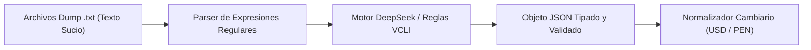

# 04 - Fase 4: Normalización & Parsing JSON (Motor DeepSeek)

> **Fase del Proceso:** 04 de 10  
> **Script Clave:** `extractores/5.DIARIO.SEMANAL.Procesador_txt.a.json.DEEPSEEK_VCLI.py`  
> **Motor de Inferencia:** DeepSeek Local / Heurísticas VCLI  
> **Entrada:** `/outputs/worker_*_dump.txt` ➔ **Salida:** `/outputs/*.json`  
> **Retorno:** [[00 - Dashboard Maestro & Arquitectura End-to-End]]  

---

## 1. El Reto del Parsing en Portales de Clasificados

Los datos en NeoAuto contienen texto desestructurado, campos mal etiquetados por vendedores, precios en Soles o Dólares mezclados, y descripciones libres donde se esconden detalles críticos (ej. *'único dueño'*, *'mantenimientos en concesionario'*, *'versión 4x4'*).



---

## 2. Esquema de Datos Extraído

Cada registro es transformado en un schema estricto con campos normalizados:

```json
{
  "url": "https://neoauto.com/auto/usado/toyota-rav4-2021-998877",
  "make": "TOYOTA",
  "model": "RAV4",
  "model_base": "Rav4",
  "year": 2021,
  "price_usd": 24500.0,
  "price_pen": 91875.0,
  "currency_original": "USD",
  "mileage_km": 42000,
  "transmission": "Automática",
  "fuel_type": "Gasolina",
  "engine_cc": 2000,
  "drive_type": "4x2",
  "location": "Lima, Miraflores",
  "seller_type": "Particular",
  "unico_dueno": true,
  "tags": ["Full Equipo", "Cámara de Retroceso", "Sunroof"],
  "fecha_extraccion": "2026-10-23T18:40:00Z"
}
```

---

## 3. Reglas de Normalización Financiera (Paridad PEN/USD)

Para permitir análisis comparativos precisos, todo precio publicado en Soles (`S/.`) es convertido automáticamente a Dólares Americanos (`USD`) utilizando la tasa de cambio de referencia del día obtenida de la base de datos o fijada en `3.75 PEN/USD`:

$$	ext{Precio}_{	ext{USD}} = rac{	ext{Precio}_{	ext{PEN}}}{	ext{Tipo de Cambio}}$$

Si el anuncio ya está en dólares, se preserva el valor original y se proyecta su equivalente en soles para análisis cruzado.
