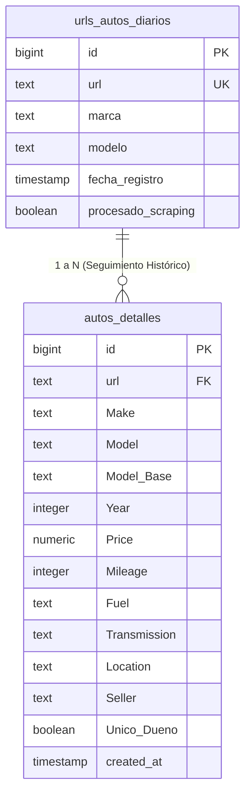

# 05 - Fase 5: Ingesta & Persistencia en Supabase

> **Fase del Proceso:** 05 de 10  
> **Script Clave:** `extractores/6.json_a_supabase.DEEP.SEEK.CRON.VCLI.py`  
> **Base de Datos:** PostgreSQL en la nube Supabase  
> **Tablas Principales:** `urls_autos_diarios`, `autos_detalles`  
> **Retorno:** [[00 - Dashboard Maestro & Arquitectura End-to-End]]  

---

## 1. Esquema Relacional de Persistencia

La persistencia en Supabase se organiza bajo una estrategia de **Doble Capa**:
1. **Capa Transaccional (`urls_autos_diarios`):** Rastreo de estado y control de colas de scraping.
2. **Capa Analítica e Histórica (`autos_detalles`):** Bodega de datos masiva donde se almacena el historial completo de precios, kilometrajes y especificaciones para entrenar los modelos de regresión.

---

## 2. Estrategia de Upsert y Deduplicación

Para evitar duplicidad en la tabla analítica:
- Se evalúa si el `URL` ya existe con el mismo `Price` y `Mileage`. Si no ha cambiado, se actualiza la fecha de último avistamiento (`updated_at`).
- Si el precio cambió (ej. una rebaja de $25,000 a $23,500), se genera un nuevo snapshot histórico que permite registrar la **velocidad de rebaja** del vendedor.

---

## 3. Auditoría de Salud Automática

Al finalizar la inserción, el script genera el reporte HTML de auditoría de salud en:
`/mnt/caddy_storage/Scraper.Neoauto/outputs/scraper_audit_report.html`

Métricas evaluadas:
- Total de registros procesados con éxito vs. descartados.
- Porcentaje de anuncios con kilometraje válido ($> 95\%$).
- Porcentaje de anuncios con precio válido ($> 98\%$).
