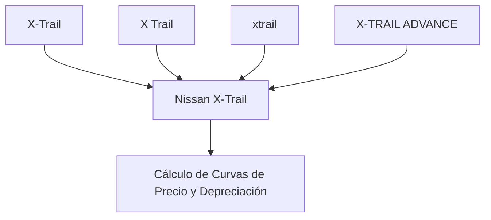

# 06 - Fase 6: Inteligencia Estadística & Regresión de Mercado

> **Fase del Proceso:** 06 de 10  
> **Módulo Clave:** `Autos.Richard.Gutierrez/generate_autos_report.py`  
> **Librerías Matemáticas:** `pandas`, `scipy.interpolate`, `numpy`, `plotly`  
> **Retorno:** [[00 - Dashboard Maestro & Arquitectura End-to-End]]  

---

## 1. Mapeo Canónico de Marcas y Modelos

Un problema común en NeoAuto es la dispersión de nombres escritos por vendedores (ej. *'X-Trail'*, *'X Trail'*, *'XTRAIL'*, *'Grand Vitara'*, *'All New Grand Vitara'*).

La función `build_canonical_model_mapping` consolida estas variantes mediante un árbol de normalización:



---

## 2. Métricas Estadísticas Calculadas por Modelo

Para cada modelo con más de 10 observaciones históricas, el motor calcula:

1. **Mediana de Precio por Año ($M_{y}$):** Más robusta que la media aritmética frente a valores atípicos (anuncios inflados o errores tipográficos).
2. **Curva Spline de Depreciación:** Interpolación cúbica suavizada con `scipy.interpolate.make_interp_spline` que proyecta la pérdida de valor anual:
   $$	ext{Depreciación Anual (\%)} = rac{M_{y} - M_{y-1}}{M_{y}} 	imes 100$$
3. **Fast Selling Ratio (FSR):** Índice de rotación que mide el porcentaje de anuncios que desaparecen del portal en menos de 14 días (vehículos de alta liquidez).
4. **Desviación de Precio del Anuncio ($Z	ext{-Score}$):**
   $$Z = rac{	ext{Precio}_{	ext{auto}} - \mu_{	ext{modelo, año}}}{\sigma_{	ext{modelo, año}}}$$
   - Si $Z < -1.5$: El vehículo está catalogado como **"Oportunidad de Compra / Ganga"**.
   - Si $Z > 1.5$: El vehículo está catalogado como **"Sobreprecio"**.

---

## 3. Filtros Interactivos Guardados (`last_filters.json`)

El reporte se calibra automáticamente según las preferencias del operador:

```json
{
  "km_max": 100000.0,
  "year_min": 2016,
  "days_back": 30,
  "selected_map": {
    "TOYOTA": ["Corolla", "Fortuner", "Hilux", "Rav4", "Rush"],
    "SUBARU": ["Forester", "XV", "Crosstrek", "Outback"],
    "MAZDA": ["Cx-3", "Cx-5", "Cx-30", "Cx-9"],
    "NISSAN": ["Frontier", "Kicks", "X-Trail"],
    "HONDA": ["Civic", "Cr-V", "Hr-V"],
    "KIA": ["Sportage", "Sorento", "Seltos"]
  },
  "fuels": ["Diesel", "Gasolina"]
}
```
