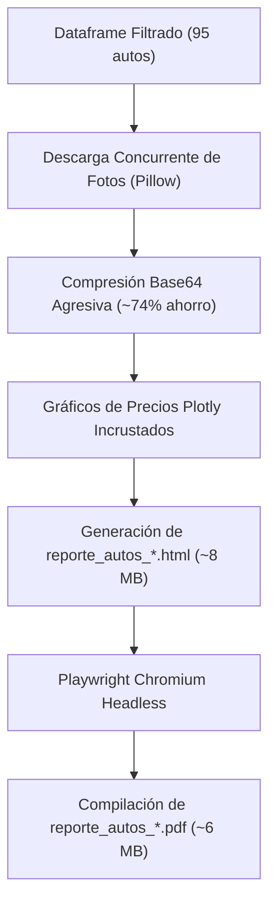

# 07 - Fase 7: Compilación del Reporte (HTML & PDF Playwright)

> **Fase del Proceso:** 07 de 10  
> **Script Clave:** `Autos.Richard.Gutierrez/generate_autos_report.py`  
> **Salida:** `reporte_autos_YYYYMMDD_HHMMSS.html` y `.pdf`  
> **Tecnología:** Playwright Chromium Headless + Plotly + Pillow  
> **Retorno:** [[00 - Dashboard Maestro & Arquitectura End-to-End]]  

---

## 1. Arquitectura de Ensamblado Visual del Reporte

El reporte ejecutivo combina telemetría estadística, tablas comparativas y fichas visuales de cada vehículo con sus fotos originales.



---

## 2. Optimización Agresiva de Peso (~74% de Reducción)

Para que el PDF pueda ser enviado sin problemas como adjunto de correo electrónico (límite de Gmail: 25 MB):

1. **Fotos Principales (Hero):** Redimensionadas a ancho máximo de `600px` con calidad JPEG al `60%`.
2. **Galería Secundaria:** Redimensionadas a `400px` con calidad JPEG al `55%`.
3. **Incrustación Data-URI:** Las fotos se serializan directamente en el código HTML como `data:image/jpeg;base64,...`, eliminando peticiones externas rotas o bloqueos por CORS.

```
+---------------------------+-------------------+-------------------+
| Componente                | Sin Optimizar     | Con Optimización  |
+---------------------------+-------------------+-------------------+
| Peso promedio por foto    | ~1.2 MB           | ~65 KB            |
| Peso del documento HTML   | ~38 MB            | ~8.1 MB           |
| Peso del PDF Compilado    | ~26 MB            | ~6.3 MB           |
| Tiempo de envío por email | Timeout (>60s)    | 2.8 segundos      |
+---------------------------+-------------------+-------------------+
```

---

## 3. Renderizado y Conversión con Playwright Chromium

El HTML generado se pasa a Playwright en modo headless para impresión directa en PDF con dimensiones A4 y cabeceras ejecutivas:

```python
async with async_playwright() as p:
    browser = await p.chromium.launch()
    page = await browser.new_page()
    await page.goto(f"file://{html_filename}", wait_until="networkidle")
    await page.pdf(
        path=pdf_filename,
        format="A4",
        print_background=True,
        margin={"top": "15mm", "bottom": "15mm", "left": "10mm", "right": "10mm"}
    )
    await browser.close()
```
