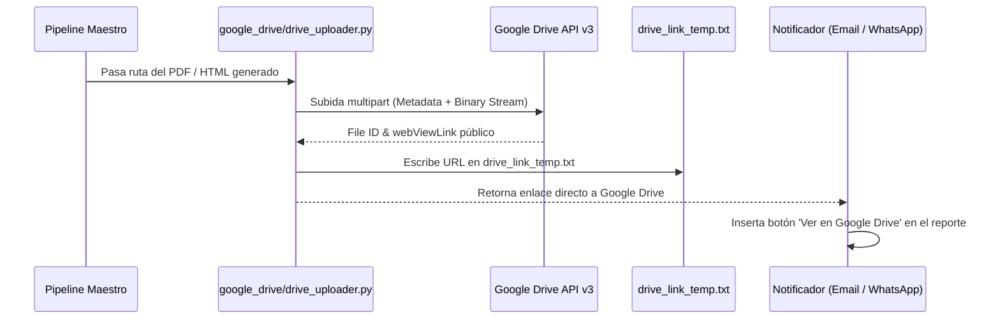

# 08 - Fase 8: Almacenamiento en Google Drive & Enlaces Compartibles

> **Fase del Proceso:** 08 de 10  
> **Script Clave:** `google_drive/drive_uploader.py`  
> **Credenciales:** `google_drive/client_secret.json` / `google_drive/token.json`  
> **API:** Google Drive API v3  
> **Retorno:** [[00 - Dashboard Maestro & Arquitectura End-to-End]]  

---

## 1. Propósito y Flujo de Almacenamiento en la Nube

Para preservar un histórico inmutable fuera de la ThinkPad y permitir que inversionistas y operadores consulten reportes pasados desde sus teléfonos sin saturar sus bandejas de entrada, el módulo `google_drive` respalda automáticamente cada reporte en la nube.



---

## 2. Configuración de Google Drive API v3

- **Scopes Requeridos:**
  * `https://www.googleapis.com/auth/drive.file` (acceso a archivos creados por la aplicación).
- **Carpeta de Destino en Drive:** Carpeta compartida `Reportes NeoAuto - GeekSoft Deals`.
- **Permisos del Archivo:** Se configuran automáticamente con rol `reader` para cualquier usuario con el enlace (`type: anyone`, `role: reader`).

---

## 3. Contenido del Archivo de Enlace Temporal (`drive_link_temp.txt`)

Una vez completada la subida, el enlace queda registrado en texto plano en la raíz del proyecto para consumo de scripts desacoplados:

```text
https://drive.google.com/file/d/1lJrX1ZNrNiSaZGvB3qRgGwtBLiToIuQB/view?usp=drivesdk
```

---

## 4. Prueba Manual de Subida a Google Drive

```bash
ssh -i C:\Users\rguti\.ssh\id_thinkpad_antigravity richgutz@192.168.0.150 "cd /mnt/caddy_storage/Scraper.Neoauto && .venv/bin/python google_drive/drive_uploader.py --test"
```
