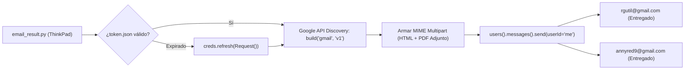

# 09 - Fase 9: Gateway de Despacho Gmail OAuth 2.0

> **Fase del Proceso:** 09 de 10  
> **Script Clave:** `Autos.Richard.Gutierrez/email_result.py` y `gmail_sender/gmail_sender.py`  
> **Proyecto Google Cloud:** `neoautogmailsender`  
> **Remitente Autenticado:** `deals.kc.2025@gmail.com`  
> **Retorno:** [[00 - Dashboard Maestro & Arquitectura End-to-End]]  

---

## 1. Arquitectura de Despacho Seguro OAuth 2.0

El envío de reportes no utiliza contraseñas de aplicación SMTP tradicionales (frecuentemente bloqueadas o revocadas por Google), sino el estándar de grado empresarial **Google OAuth 2.0 con tokens de refresco (Refresh Tokens)**:



---

## 2. Identidad y Credenciales de Producción

- **Cuenta Remitente Oficial:** `deals.kc.2025@gmail.com`
- **Client ID:** `499463343361-nlbg62bevc9mr227sm586bs5qtg750k8.apps.googleusercontent.com`
- **Ubicación del Token Activo:** `/mnt/caddy_storage/Scraper.Neoauto/gmail_sender/token.json`
- **Copia de Respaldo Local:** `C:\Users\rguti\Scraper.Neoauto\gmail_sender\token.json`
- **Lista de Destinatarios:**
  * `/mnt/caddy_storage/Scraper.Neoauto/gmail_sender/destinatarios.txt`
  * `/mnt/caddy_storage/Scraper.Neoauto/gmail_sender/destinatarios_richard_gutierrez.txt`

---

## 3. Autopsia Forense (RCA) y Blindaje Anti-Regresión: `invalid_scope`

> [!CAUTION]
> ### 🛑 LECCIÓN APRENDIDA Y MANDATO INQUEBRANTABLE DE SCOPES OAUTH 2.0
> **Fecha del Incidente:** 23 de Octubre de 2026  
> **Síntoma:** El reporte de las 19:36 PM se compiló a PDF exitosamente pero falló en el envío arrojando:  
> `google.auth.exceptions.RefreshError: ('invalid_scope: Bad Request', {'error': 'invalid_scope', 'error_description': 'Bad Request'})`

### A. Causa Raíz (RCA)
1. Durante la re-autorización del flujo OAuth en Google Cloud (`neoautogmailsender`), se concedieron permisos explícitos para:
   - `https://www.googleapis.com/auth/gmail.send` (Envío de correos)
   - `https://www.googleapis.com/auth/gmail.modify` (Gestión y limpieza de enviados)
2. El archivo de credenciales de usuario `token.json` guardó exactamente estos dos scopes autorizados en el consent screen.
3. Sin embargo, en el código fuente heredado de `gmail_sender/gmail_sender.py`, la lista `SCOPES` contenía un tercer scope huérfano:
   ```python
   # ERROR PREVIO (PROHIBIDO):
   SCOPES = [
       'https://www.googleapis.com/auth/gmail.send',
       'https://www.googleapis.com/auth/gmail.modify',
       'https://www.googleapis.com/auth/contacts'  # <--- SCOPE NO AUTORIZADO
   ]
   ```
4. Mientras el `access_token` inicial estuvo vigente en memoria, el script envió correos. Pero al expirar la sesión de 1 hora, la función `creds.refresh(Request())` solicitó a Google renovar el token pidiendo los 3 scopes. Al no estar `contacts` autorizado en el proyecto de Google Cloud, Google rechazó inmediatamente la solicitud con `invalid_scope: Bad Request`.

### B. Regla Inmutable de Código (Quality Gate 9)
Queda **terminantemente prohibido** declarar scopes en `gmail_sender.py` que no correspondan exactamente a los autorizados en el consentimiento de Google Cloud. El bloque oficial e inmutable es:

```python
# ESTÁNDAR CANÓNICO OBLIGATORIO:
SCOPES = [
    'https://www.googleapis.com/auth/gmail.send',
    'https://www.googleapis.com/auth/gmail.modify'
]
```

---

## 4. Plantilla de Correo HTML y Adjunto PDF

El correo enviado incluye:
1. Resumen ejecutivo de vehículos nuevos ingresados hoy.
2. Botón directo de descarga y visualización en Google Drive.
3. El archivo `reporte_autos_YYYYMMDD_HHMMSS.pdf` adjunto directamente optimizado con imágenes base64 a 60% de calidad.

---

## 5. Auditoría y Comando de Envío en Vivo

Para despachar manualmente el informe más reciente existente en disco:
```bash
ssh -i C:\Users\rguti\.ssh\id_thinkpad_antigravity richgutz@192.168.0.150 "cd /mnt/caddy_storage/Scraper.Neoauto && .venv/bin/python Autos.Richard.Gutierrez/email_result.py"
```

Salida de certificación exitosa (23-Oct-2026):
```text
Latest PDF found: /mnt/caddy_storage/Scraper.Neoauto/Autos.Richard.Gutierrez/reporte_autos_20261023_193639.pdf
Sending email to rgutil@gmail.com...
Email sent successfully to rgutil@gmail.com! ID: 1a16b5cd9f992885
Sending email to annyred9@gmail.com...
Email sent successfully to annyred9@gmail.com! ID: 1a16b5ce756df4c1
```
