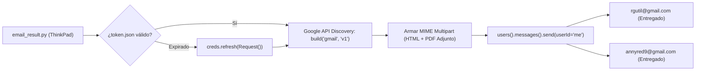

# 09 - Fase 9: Gateway de Despacho Gmail OAuth 2.0

> **Fase del Proceso:** 09 de 10  
> **Script Clave:** `Autos.Richard.Gutierrez/email_result.py` y `gmail_sender/gmail_sender.py`  
> **Proyecto Google Cloud:** `neoautogmailsender`  
> **Remitente Autenticado:** `deals.kc.2025@gmail.com`  
> **Retorno:** [[00 - Dashboard Maestro & Arquitectura End-to-End]]  

---

## 1. Arquitectura de Despacho Seguro OAuth 2.0

El envío de reportes no utiliza contraseñas de aplicación SMTP tradicionales (frecuentemente bloqueadas o revocadas por Google), sino el estándar de grado empresarial **Google OAuth 2.0 con tokens de refresco (Refresh Tokens)**:



---

## 2. Identidad y Credenciales de Producción

- **Cuenta Remitente Oficial:** `deals.kc.2025@gmail.com`
- **Client ID:** `499463343361-nlbg62bevc9mr227sm586bs5qtg750k8.apps.googleusercontent.com`
- **Ubicación del Token Activo:** `/mnt/caddy_storage/Scraper.Neoauto/gmail_sender/token.json`
- **Copia de Respaldo Local:** `C:\Users\rguti\Scraper.Neoauto\gmail_sender\token.json`
- **Lista de Destinatarios:**
  * `/mnt/caddy_storage/Scraper.Neoauto/gmail_sender/destinatarios.txt`
  * `/mnt/caddy_storage/Scraper.Neoauto/gmail_sender/destinatarios_richard_gutierrez.txt`

---

## 3. Plantilla de Correo HTML

El correo enviado incluye:
1. Resumen ejecutivo de vehículos nuevos ingresados hoy.
2. Botón directo de descarga y visualización en Google Drive.
3. El archivo `reporte_autos_YYYYMMDD_HHMMSS.pdf` adjunto directamente.

---

## 4. Auditoría y Comando de Envío en Vivo

Para despachar manualmente el informe más reciente existente en disco:
```bash
ssh -i C:\Users\rguti\.ssh\id_thinkpad_antigravity richgutz@192.168.0.150 "cd /mnt/caddy_storage/Scraper.Neoauto && .venv/bin/python Autos.Richard.Gutierrez/email_result.py"
```

Salida esperada de entrega:
```text
Latest PDF found: /mnt/caddy_storage/Scraper.Neoauto/Autos.Richard.Gutierrez/reporte_autos_20261023_162257.pdf
Sending email to rgutil@gmail.com...
Email sent successfully to rgutil@gmail.com! ID: 1a16aa5d98556360
Sending email to annyred9@gmail.com...
Email sent successfully to annyred9@gmail.com! ID: 1a16aa5e663a2e72
```
