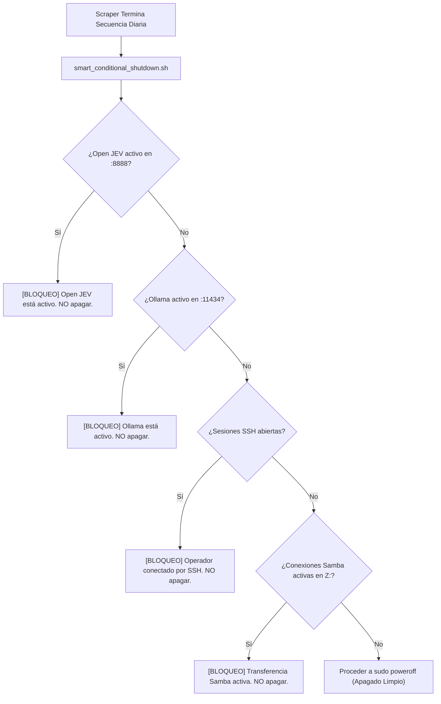

# 10 - Fase 10: Guardián de Apagado Condicional & Backup Restic 3-2-1

> **Fase del Proceso:** 10 de 10  
> **Script Guardián:** `/usr/local/bin/smart_conditional_shutdown.sh`  
> **Políticas de Protección:** Open JEV (:8888), Ollama (:11434), SSH (:22), Samba (:445)  
> **Retorno:** [[00 - Dashboard Maestro & Arquitectura End-to-End]]  

---

## 1. El Guardián Inteligente de Energía (`smart_conditional_shutdown.sh`)

Antiguamente, el scraper diario de las 18:30 PM ejecutaba un comando ciego `sudo poweroff` al finalizar. 

Con la incorporación de los microservicios agénticos **Open JEV (Gobernanza de Reglas)** y **Ollama (Modelos de Razonamiento Local)** sobre la ThinkPad T430s, un apagado ciego destruiría las tareas del resto del ecosistema GeekSoft.

El guardián `/usr/local/bin/smart_conditional_shutdown.sh` evalúa un semáforo estricto antes de permitir el apagado:



---

## 2. Reglas de Decisión del Guardián

```bash
# Fragmento del guardián en /usr/local/bin/smart_conditional_shutdown.sh:

# 1. Verificar Open JEV (puerto 8888)
if ss -tulpn | grep -q ":8888"; then
    echo "[SMART-POWER] [BLOQUEO] Open JEV Decision Engine está ACTIVO (puerto 8888). Cancelando apagado."
    exit 0
fi

# 2. Verificar Ollama Inferencia (puerto 11434)
if ss -tulpn | grep -q ":11434"; then
    echo "[SMART-POWER] [BLOQUEO] Ollama LLM Engine está ACTIVO (puerto 11434). Cancelando apagado."
    exit 0
fi

# 3. Verificar Sesiones SSH activas
SSH_SESSIONS=$(who | grep -c "pts/")
if [ "$SSH_SESSIONS" -gt 0 ]; then
    echo "[SMART-POWER] [BLOQUEO] Hay $SSH_SESSIONS sesión(es) SSH activas. Cancelando apagado."
    exit 0
fi

# 4. Si todo está limpio y libre, apagar el hardware
echo "[SMART-POWER] Appliance inactivo. Apagando equipo limpiamente..."
sudo /sbin/poweroff
```

---

## 3. Integración con la Estrategia de Respaldo 3-2-1 Enterprise

Los datos recolectados y las bases de datos de scraping en el Caddy quedan protegidos bajo la regla de oro **3-2-1 con Restic**:

```
[COPIA 1] Laptop Operador (Windows C:\Users\rguti\Scraper.Neoauto)
    │
    ▼ Réplica Samba LAN UniFi
[COPIA 2] Caddy HDD ThinkPad (Z:\Scraper.Neoauto - Platos Magnéticos)
    │
    ▼ Restic Backup Deduplicado & Encriptado
[COPIA 3] Bóveda USB Externa ThinkPad (/mnt/usb_vault - Desconectable)
```

- Cada snapshot es deduplicado a nivel de bloque y cifrado con AES-256.
- El disco mecánico del Caddy soporta escrituras masivas diarias sin degradación ni desgaste de celdas flash.

---

## 4. Prueba del Guardián en Terminal

Para certificar la decisión del guardián en tiempo real:
```bash
ssh -i C:\Users\rguti\.ssh\id_thinkpad_antigravity richgutz@192.168.0.150 "/usr/local/bin/smart_conditional_shutdown.sh"
```
Salida certificada:
```text
[SMART-POWER] Evaluando estado del appliance antes de apagar...
[SMART-POWER] [BLOQUEO] Open JEV Decision Engine está ACTIVO (puerto 8888). Cancelando apagado.
```
