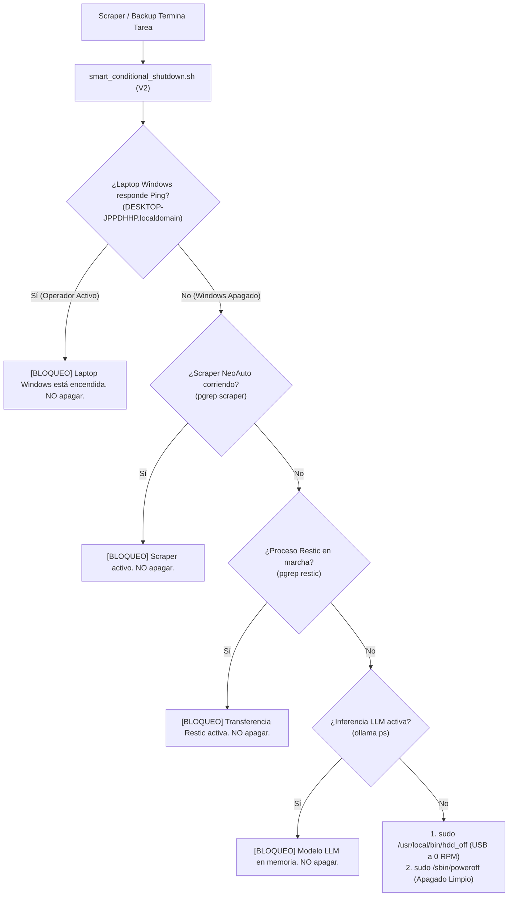

# 10 - Fase 10: Guardián de Apagado Condicional & Backup Restic 3-2-1

> **Fase del Proceso:** 10 de 10  
> **Script Guardián:** `/usr/local/bin/smart_conditional_shutdown.sh` (V2)  
> **Guardián de Inactividad Win32:** `C:\Users\rguti\bin\inactivity_watchdog.ps1`  
> **Políticas de Protección:** Presencia Windows LAN (Ping <1ms), Scraper Activo, Restic Activo, Inferencia Ollama  
> **Retorno:** [[00 - Dashboard Maestro & Arquitectura End-to-End]]  

---

## 1. El Guardián Inteligente de Energía (`smart_conditional_shutdown.sh` V2)

Antiguamente, el scraper diario de las 18:30 PM ejecutaba un comando ciego `sudo poweroff` al finalizar. 

Con la infraestructura agéntica moderna y la estrategia **3-2-1 Enterprise**, un apagado ciego destruiría las tareas en curso (por ejemplo, si el usuario sigue programando en su laptop o si hay una réplica de backup en proceso).

El guardián `/usr/local/bin/smart_conditional_shutdown.sh` (Versión 2 Enterprise) evalúa un semáforo estricto de presencia y procesos activos antes de permitir el apagado:



---

## 2. Lógica del Guardián V2 en la ThinkPad

```bash
#!/bin/bash
# /usr/local/bin/smart_conditional_shutdown.sh (V2 Enterprise)
echo "[SMART-POWER] Evaluando estado del cluster ThinkPad antes de apagar..."

# 1. Regla Crítica: Presencia de la Laptop de Desarrollo en LAN UniFi
# Si Windows sigue encendido, el operador sigue trabajando. NO APAGAR.
if ping -c 1 -W 1 DESKTOP-JPPDHHP.localdomain >/dev/null 2>&1; then
    echo "[SMART-POWER] [BLOQUEO] Laptop Windows (DESKTOP-JPPDHHP) sigue ON en LAN UniFi. ThinkPad permanece despierta."
    exit 0
fi

# 2. Verificar si el Scraper de NeoAuto sigue en ejecucion
if pgrep -f "scraper" >/dev/null 2>&1 || pgrep -f "extractores" >/dev/null 2>&1; then
    echo "[SMART-POWER] [BLOQUEO] Scraper de NeoAuto sigue en ejecucion. Cancelando apagado."
    exit 0
fi

# 3. Verificar si Restic sigue respaldando o replicando
if pgrep -x "restic" >/dev/null 2>&1; then
    echo "[SMART-POWER] [BLOQUEO] Motor Restic activo transfiriendo datos. Cancelando apagado."
    exit 0
fi

# 4. Verificar si Ollama tiene modelos cargados en memoria
if command -v ollama >/dev/null 2>&1; then
    ACTIVE_MODELS=$(ollama ps 2>/dev/null | grep -v "NAME" | wc -l)
    if [ "$ACTIVE_MODELS" -gt 0 ]; then
        echo "[SMART-POWER] [BLOQUEO] Ollama tiene $ACTIVE_MODELS modelo(s) en inferencia activa. Cancelando apagado."
        exit 0
    fi
fi

# 5. Todo limpio: Apagar disco USB por software y apagar equipo
echo "[SMART-POWER] Sistema ocioso y seguro. Apagando boveda USB a 0 RPM..."
/usr/local/bin/hdd_off >/dev/null 2>&1
echo "[SMART-POWER] Apagando ThinkPad limpiamente..."
sudo /sbin/poweroff
```

---

## 3. Guardián de Inactividad en Windows (`inactivity_watchdog.ps1`)

Para que el backup no apague la PC si el usuario continúa redactando o investigando:
- **Win32 API:** Utiliza `user32.dll!GetLastInputInfo`.
- **Cero consumo de CPU:** Consulta los milisegundos desde la última pulsación de tecla o movimiento de ratón.
- **Ventana de Seguridad:** Si transcurren **300 segundos (5 minutos continuos)** sin interacción humana tras el backup, envía la señal de apagado ordenado a la ThinkPad y luego a Windows.

---

## 4. Doble Reposo Motriz a 0 RPM

| Dispositivo | Mecanismo de Reposo | Comportamiento Físico |
| :--- | :--- | :--- |
| **Caddy HDD SATA (`/dev/sdb`)** | `/etc/hdparm.conf` (APM 127, Spindown 120) | Se apaga automáticamente a los 10 minutos de inactividad magnética. |
| **Bóveda USB NTFS (`/dev/sdd1`)** | `/usr/local/bin/hdd_off` (xHCI unbind & power-off) | Corta la energía del bus USB al terminar la replicación Restic. |

---

## 5. Integración con la Estrategia de Respaldo 3-2-1 Enterprise

Los datos recolectados y las bases de datos de scraping en el Caddy quedan protegidos bajo la regla de oro **3-2-1 con Restic**:

```
[COPIA 1] Laptop Operador (Windows C:\Users\rguti\Scraper.Neoauto)
    │
    ▼ Streaming Restic 1 Gbps LAN UniFi
[COPIA 2] Caddy HDD ThinkPad (Z:\repos_backup - Platos Magnéticos)
    │
    ▼ restic copy Interno (>30 MB/s)
[COPIA 3] Bóveda USB Externa ThinkPad (/mnt/usb_vault - Desacoplada a 0 RPM)
```

- Cada snapshot es deduplicado a nivel de bloque y cifrado con AES-256.
- El disco mecánico del Caddy soporta escrituras masivas diarias sin degradación ni desgaste de celdas flash.

---

## 6. Prueba del Guardián en Terminal

Para certificar la decisión del guardián en tiempo real:
```bash
ssh thinkpad "/usr/local/bin/smart_conditional_shutdown.sh"
```
Salida certificada:
```text
[SMART-POWER] Evaluando estado del cluster ThinkPad antes de apagar...
[SMART-POWER] [BLOQUEO] Laptop Windows (DESKTOP-JPPDHHP) sigue ON en LAN UniFi. ThinkPad permanece despierta.
```
